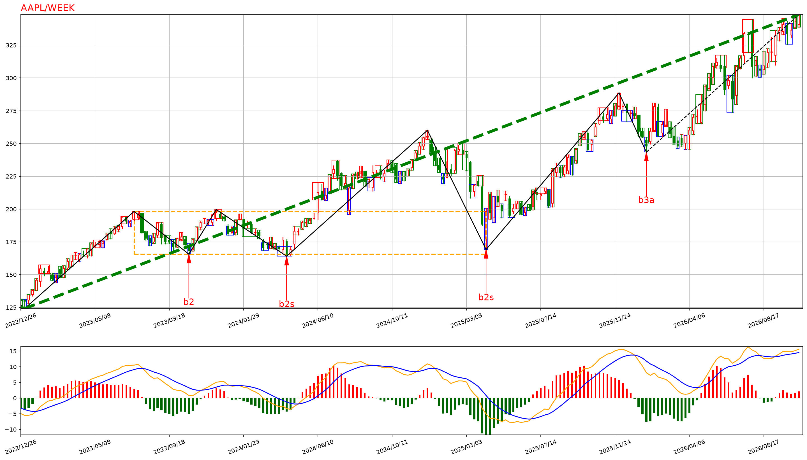
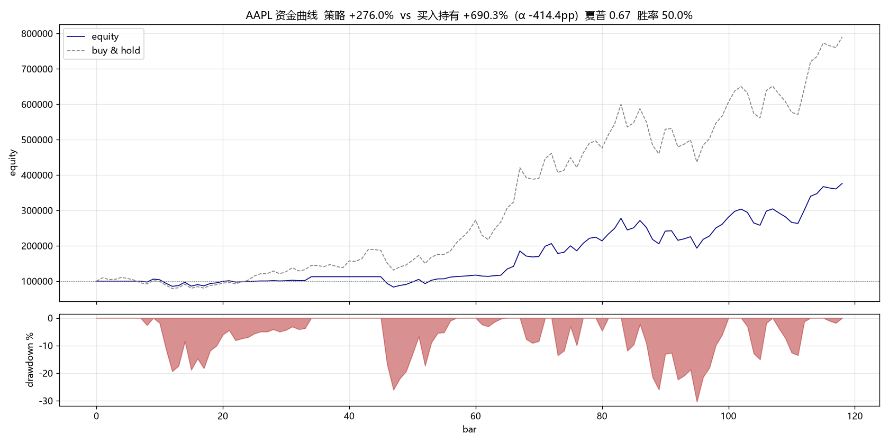

# YUE_Chan

[**English**](./README.md) | [中文](./README_zh.md)

**A multi-market quantitative-trading system built on Chan theory (缠论 / "the mathematical principles of market philosophy").**

YUE_Chan turns Chan theory from a chart-marking hobby into a backtestable, live-tradable system. It implements a full pipeline — fractal → stroke → segment → center → divergence → three buy/sell points — with multi-timeframe analysis, a set of ten independently toggleable "level/trend discipline" gates, a long/short strategy engine, backtesting across US / HK / A-share / crypto (each with its own market rules applied automatically), and broker execution bridges. Pure Python, no commercial market-data terminal required.

> This is a research / educational project. It is **not** investment advice. See [Disclaimer](#disclaimer).

---

## Preview

**Chan structure** — AAPL weekly: merged K-lines, strokes/segments (black), a center (orange box), trend line (green dashed), buy/sell points (`b2` / `b2s` / `b3a`), MACD below.



**Backtest equity curve** — AAPL 2015–2024, multi-level (month > week > day): +292.69% total, Sharpe 0.68, 75% win rate; drawdown below.



---

## Contents

- [Why this project](#why-this-project)
- [Highlights](#highlights)
- [Architecture](#architecture)
- [Quickstart](#quickstart)
- [The ten discipline layers](#the-ten-discipline-layers)
- [Data sources](#data-sources)
- [Strategy engine](#strategy-engine)
- [Backtesting](#backtesting)
- [Rotation & live trading](#rotation--live-trading)
- [Market-capability layer](#market-capability-layer)
- [Project layout](#project-layout)
- [Glossary](#glossary)
- [Documentation map](#documentation-map)
- [Disclaimer](#disclaimer)

---

## Why this project

Chan theory (by the anonymous Chinese blogger *缠中说禅*) defines a rigorous, recursive geometry of price: fractals, strokes, segments, centers, and three classes of buy/sell points, all relative to a *level* (timeframe). Most open-source implementations stop at drawing these objects on a chart.

YUE_Chan goes further:

- **A complete computation engine** — fractal / stroke / segment / center / divergence / buy-sell points, multi-level nesting and "interval套" (nested-interval) precision entry, plus MACD / MA / Bollinger / Demark indicators. `CChan.toJson()` can be deployed behind an API.
- **Levels actually run in live decisions** — ten discipline layers (see below) operationalize the theory's most-hand-wavy part: *which level a signal really belongs to, and what it means for the position you hold*.
- **Long/short symmetry** — Chan's "every trend completes" is direction-agnostic; short rules mirror long rules, with asymmetric stop-loss handling.
- **One codebase, four markets** — replay bar-by-bar and backtest any symbol, any date range; commissions / stamp duty / transfer fees / T+1 / lot size / short-selling constraints are applied per market automatically.
- **Execution bridges** — a broker-agnostic executor with Alpaca (US) and Futu (HK/A/US) adapters, paper or live.

## Highlights

- **Faithful, algorithmic Chan theory.** Every algorithmically-expressible lesson of the 108-lesson original text is implemented; the [implementation status matrix](./IMPLEMENTATION_STATUS.md) maps each lesson to its code (Chinese).
- **Ten discipline gates, each independently switchable** — so every layer's contribution can be measured by ablation, not asserted.
- **Empirical, honest reporting.** Divergence criteria, why shorting fails on some markets, flip-vs-flat, stop-loss and level-gating behaviour are all backed by ablation experiments in [RESEARCH.md](./RESEARCH.md) (Chinese); result artifacts live in [`results/`](./results).
- **Offline self-check.** `python Script/SmokeOffline.py` runs the whole pipeline on synthetic data (no network) — run it after any change.

## Architecture

```
Data sources     → yfinance (US/HK/A-shares, routed by ticker suffix) / BaoStock (A-share) / ccxt (crypto)
    ↓
K-line layer     → CKLine_Unit (raw) → CKLine (merged) → CKLine_List (per-level pipeline)
    ↓
Chan engine      → CBiList (strokes) → CSegListChan (segments) → CZSList (centers) → CBSPointList (buy/sell pts)
    ↓
Trend analysis   → TrendAnalyzer (trend type / completion / center evolution)
(Trend/)           LevelLinkage · SameLevelDecompose · MiddleYin · MATrend · SmallTurnBig
                   ZSOscillation · ReboundTrader · InsideOutside · FugueDecompose · EnergyDynamics
    ↓
Market capability→ MarketCapability (shorting / T+0 / stamp duty / lot) + detect_market (route by suffix)
    ↓               ↑ gates: A-shares block shorts, T+1 close constraint, 100-share lot
Strategy engine  → ChanStrategy / ChanNestedStrategy (nested-interval entry)
(Strategy/)        ↑ the ten discipline gates modulate every signal
    ↓
Execution        → Backtester (replay) | ChanTradeExecutor (broker-agnostic)
    ↓                                        ↓ dispatched by --broker
Brokers          → BaseTrader (abstract) → AlpacaTrader (US) / FutuTrader (HK/A/US)
```

## Quickstart

### Install

```bash
pip install -r Script/requirements.txt
```

Core deps: `numpy`, `pandas`, `matplotlib`, `yfinance`. Optional: `baostock` (A-share alt source), `ccxt` (crypto), `futu-api` (HK/A/US trading), `alpaca-py` (US trading). Requires Python ≥ 3.11.

> US / HK / A-share quotes all come from **yfinance** (`--data-src yfinance`, the default) — no per-market library needed.

### Analyze (structure + the ten layers)

```bash
# US stock, three linked levels (month > week > day), operating level = day
python MainChan.py --mode analyze --symbol AAPL --lv month,week,day --start 2015-01-01

# HK stock, two levels
python MainChan.py --mode analyze --symbol 0700.HK --lv week,day --start 2019-01-01

# A-share, forward-adjusted
python MainChan.py --mode analyze --symbol 600519.SS --autype qfq --start 2020-01-01

# render charts
python MainChan.py --mode analyze --symbol AAPL --plot
```

### Backtest (any market · any symbol · any window)

```bash
python MainChan.py --mode backtest --symbol AAPL   --start 2022-01-01 --end 2024-12-31   # US: shorting + T+0
python MainChan.py --mode backtest --symbol 0700.HK --start 2019-01-01 --end 2024-12-31   # HK: shorting + T+0 + two-side stamp duty
python MainChan.py --mode backtest --symbol 600519.SS --autype qfq --start 2020-01-01      # A-share: shorts auto-disabled, T+1, 100-share lot
python MainChan.py --mode backtest --symbol NVDA --lv day --nested --div-rate 0.85         # nested-interval entry
python MainChan.py --mode backtest --symbol AAPL --no-level-linkage --no-ma                # ablate individual layers
```

The engine infers the market from the ticker suffix and applies the matching rules (commissions / stamp duty / transfer fees, T+0 vs T+1, minimum lot, short availability).

### Live / paper

```bash
export ALPACA_API_KEY=xxx ALPACA_API_SECRET=xxx
python MainChan.py --mode live --symbol AAPL --broker alpaca --paper

export FUTU_PWD_MD5=xxx
python MainChan.py --mode live --symbol 0700.HK --broker futu --paper --dry-run   # print only, no order
```

## The ten discipline layers

All ten layers act on the buy/sell points produced at the **operating level** (the smallest `--lv`, day by default), gating *whether to act and with what size*. Layers ①–⑨ are on by default (each has a `--no-…` flag); ⑩ is off by default (`--use-energy`).

| # | Layer | Module | Chan lessons | What it does |
|---|-------|--------|-----------|--------------|
| ① | Multi-level linkage + cross-level divergence attribution | `Trend/LevelLinkage.py` | 16/21, 24/27 | A reversal at the operating level must be *endorsed* by a higher level; otherwise it is treated as a sub-level pullback — hold the trend, don't open counter-trend, no shorting on the sell point. |
| ② | Same-level decomposition | `Trend/SameLevelDecompose.py` | 37/38 | Split the operating-level move into a chain of same-level trend types; keep holding while the current segment is not yet "completed". |
| ③ | Middle-Yin (transition) phase | `Trend/MiddleYin.py` | 89 | The ambiguous window after a turn before a new center / 3rd-type point confirms — de-weight new entries. |
| ④ | MA strength / rotation | `Trend/MATrend.py` + `Strategy/Rotation.py` | 106 | Bullish MA alignment suppresses counter-trend shorts and reinforces trend holds; rotation ranks a candidate pool by strength. |
| ⑤ | Small-turns-big | `Trend/SmallTurnBig.py` | 44 | Higher level shows no divergence, but a sub-level divergence breaks the higher-level structure → allow a reduced early counter-trend entry. |
| ⑥ | Center-oscillation monitor | `Trend/ZSOscillation.py` | 92 | While the center is not broken by a 3rd-type point, trade the box: buy the lower edge, sell the upper edge. |
| ⑦ | Short-term rebound | `Trend/ReboundTrader.py` | 107 | After a sharp drop, take a light first-buy-point rebound with a mechanical target and stop. |
| ⑧ | Inside–outside relation | `Trend/InsideOutside.py` | 91/93/99 | Parent-level trend × operating-level segment: counter-trend-but-parent-trend = continuation (hold); parent-complete + segment divergence = turn confirmed. |
| ⑨ | Multiple fugue | `Trend/FugueDecompose.py` | 40 | Run same-level decomposition on every level as "voices"; voices in unison → size up, voices conflict → block counter-trend. |
| ⑩ | Energy dynamics *(off by default)* | `Trend/EnergyDynamics.py` | 104 | MACD-based energy proxy; energy divergence (new price extreme + ≥20% energy decay) vetoes trend-chasing and permits an early exit. |

Each layer's real contribution is measured, not claimed — see the ablation studies in [RESEARCH.md](./RESEARCH.md).

## Data sources

A single `DATA_SRC` enum switches sources; **yfinance covers US / HK / A-shares in one place**, and the market is inferred from the ticker suffix.

| Source | CLI | Markets | Ticker format |
|--------|-----|---------|---------------|
| yfinance (default) | `yfinance` | US / HK / A-share | `AAPL` · `0700.HK` · `600519.SS` · `000001.SZ` |
| BaoStock | `bao_stock` | A-share | `sh.600000` / `sz.000001` |
| ccxt | `ccxt` | Crypto | `BTC/USDT` |
| Local / custom | `custom:file:Class` | any | any |

Supported bar levels (`KL_TYPE`): year / quarter / month / week / day and 1/3/5/15/30/60-minute. Multi-level analysis needs enough history on the higher levels — with `--lv month,week,day`, start about 8–10 years back.

## Strategy engine

**Position state machine** — buy/sell points drive `EMPTY → LONG_PARTIAL → LONG_FULL → (exit) → EMPTY`, with a mirrored short path when shorting is allowed. By default a counter-signal first returns to flat (`flip_long/flip_short=False`); a sell point says "this up-move is over", not "the next move is down", so it does not immediately flip to short.

**Three classes of buy/sell points**

| Type | Trigger | Long | Short |
|------|---------|------|-------|
| T1 / T1P | trend divergence (≥2 same-direction centers) / consolidation divergence (1 center) | open 30% | open 30% (needs level endorsement + not-bullish MA) |
| T2 / T2S | post-T1 pullback that fails to make a new extreme | add 40% | add short |
| T3A / T3B | retest after leaving the center does not return | fill to 100% | fill short |

**Fractal confirmation** (`require_fx_confirm`, default on): a signal is not acted on until the matching bottom/top fractal forms on 1–3 merged K-lines, avoiding "catching a falling knife"; it expires after 10 bars.

**Asymmetric stops**: longs have no mechanical stop by default (exit on sell points, let winners run); shorts keep a structural stop (unbounded loss risk). Full derivation in [RESEARCH.md](./RESEARCH.md).

## Backtesting

`Strategy/Backtester.py` replays bar-by-bar and returns a `BacktestResult` (total / annualized return, max drawdown, Sharpe, win rate, profit/loss ratio, cost, average holding).

```python
from Strategy.Backtester import Backtester
from Strategy.ChanStrategy import StrategyConfig
from Common.CEnum import KL_TYPE, DATA_SRC, AUTYPE

bt = Backtester(
    code="0700.HK", begin_time="2019-01-01", end_time="2024-12-31",
    data_src=DATA_SRC.US_STOCK,               # yfinance: US/HK/A-share
    lv_list=[KL_TYPE.K_WEEK, KL_TYPE.K_DAY],  # multi-level, large → small
    strategy_config=StrategyConfig(
        operating_lv=KL_TYPE.K_DAY,
        lv_list=[KL_TYPE.K_WEEK, KL_TYPE.K_DAY],
        use_level_linkage=True, use_same_level_decompose=True,
        use_middle_yin=True, use_ma_filter=True,
    ),
    initial_capital=100000, autype=AUTYPE.QFQ,
)
result = bt.run()
bt.print_report(result)
```

Per-layer ablation and per-trade attribution:

```bash
python Script/AblationStudy.py --symbols AAPL,MSFT --start 2022-01-01 --end 2024-06-30
python Script/DumpTrades.py   --symbol 1810.HK --energy veto
```

## Rotation & live trading

`--mode rotate` ranks a candidate pool by trend strength (`Strategy/Rotation.py`) — a "pick the strongest" layer orthogonal to single-symbol Chan signals; feed the winners into `backtest` / `live`.

```bash
python MainChan.py --mode rotate --symbols AAPL,MSFT,NVDA,0700.HK,600519.SS \
    --start 2023-01-01 --rotate-window 60 --rotate-top 3
```

Live execution is broker-agnostic: `ChanTradeExecutor` translates each recorded action into `BaseTrader` calls (`buy/sell/get_positions/get_account_info/get_price`). Add a broker by subclassing `BaseTrader`; Alpaca (US) and Futu (HK/A/US) ship in `Trade/`.

## Market-capability layer

`Common/MarketCapability.py` centralises per-market rules so the strategy and backtester adapt automatically:

| Market | Short | T+0 | Stamp duty | Commission | Transfer fee | Lot |
|--------|-------|-----|-----------|-----------|--------------|-----|
| A-share | ❌ (retail) | ❌ T+1 | 0.05% one-side | 0.025% (min ¥5) | 0.001% | 100 |
| HK | ✅ | ✅ | 0.1% two-side | 0.03% | 0.002% | 100 |
| US | ✅ | ✅ | 0 | 0.05% | 0 | 1 (fractional) |
| Crypto | ✅ (perp) | ✅ | 0 | 0.1% | 0 | 1 (fractional) |

`detect_market()` routes by suffix/prefix; shorts are force-disabled for A-shares even if `enable_short=True`.

## Project layout

```
YUE_Chan/
├── Bi/  Seg/  ZS/  BuySellPoint/  Combiner/   # Chan geometry: stroke / segment / center / buy-sell / K-line merge
├── KLine/  Math/                              # K-line containers & indicators (MACD/BOLL/Demark/trend)
├── Common/                                    # enums, time, exceptions, cache, divergence utils, market capability
├── Trend/                                     # trend analysis + the ten discipline layers
├── DataAPI/                                   # yfinance / BaoStock / ccxt adapters
├── Strategy/                                  # ChanStrategy · Backtester · Rotation
├── Trade/                                     # BaseTrader · Alpaca · Futu
├── Plot/                                      # static & animated charts
├── Script/                                    # offline smoke test · ablation · trade dump · buy&hold · energy advisor
├── results/                                   # experiment artifacts (CSV / MD / charts)
├── Chan.py · ChanConfig.py · MainChan.py      # engine · config · unified CLI (analyze/backtest/rotate/live)
```

## Glossary

Chan theory has no settled English vocabulary, so key terms keep their pinyin:

| Term | Meaning |
|------|---------|
| klu / klc | a raw K-line / a merged K-line |
| bi / seg | stroke / segment (a stroke is the smallest swing; a segment is made of ≥3 strokes) |
| zs (zhongshu / 中枢) | **center** — the overlap zone of consecutive moves |
| bsp | buy/sell point |
| T1/T1P · T2/T2S · T3A/T3B | 1st (trend / consolidation divergence) · 2nd / pseudo-2nd · 3rd class points |
| beichi (背驰 / divergence) | exit-move strength < entry-move strength (MACD-assisted) |
| "trend must complete" (走势终完美) | every trend type at every level eventually finishes and converts |
| nested interval (区间套) | higher level sets direction, lower levels converge on a precise entry |
| level attribution (级别归属) | which level a divergence signal truly belongs to |
| middle-Yin (中阴) | the direction-undetermined phase right after a turn |

## Documentation map

- **[README_zh.md](./README_zh.md)** — full Chinese README (more detailed configuration reference).
- **[quick_guide.md](./quick_guide.md)** — command cheat-sheet (Chinese).
- **[RESEARCH.md](./RESEARCH.md)** — ablation studies and empirical findings (Chinese).
- **[IMPLEMENTATION_STATUS.md](./IMPLEMENTATION_STATUS.md)** — lesson-by-lesson implementation matrix (Chinese).
- **Per-module `README.md`** in each subfolder — detailed write-ups of the Chan concept and its implementation, quoting the relevant original lessons (Chinese).

## Disclaimer

This project is for learning and research only and is **not** investment advice. Backtest returns are based on historical data and simplified market models (no slippage/impact, liquidity constraints, or full corporate-action handling); **past performance does not guarantee future results**. Chan buy/sell-point identification involves subjective criteria and is parameter-sensitive; you trade at your own risk.

## License

[MIT](./LICENSE) · Copyright (c) 2022-2026 YUEeee-ai

## Acknowledgements

- [Alpaca Markets](https://alpaca.markets/) — US paper-trading API.
- 缠中说禅, *Market Philosophy's Mathematical Principles* — the strategy's conceptual foundation.
