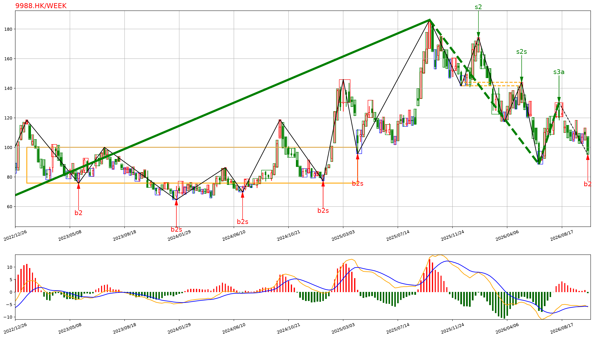
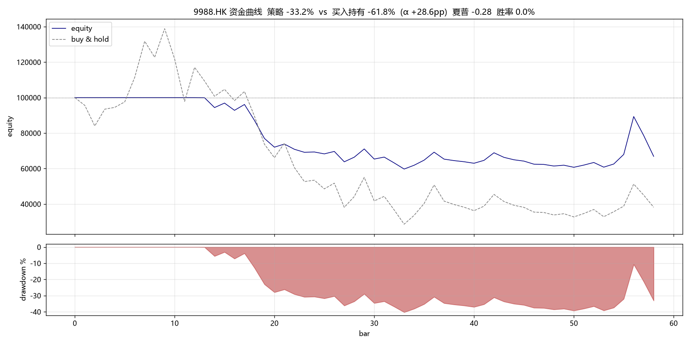
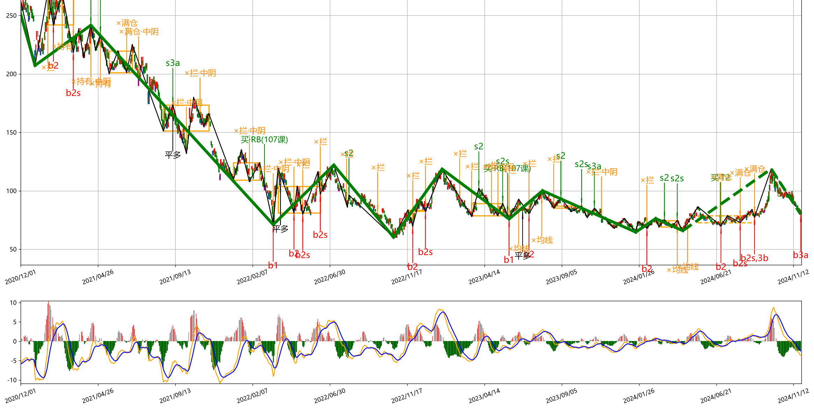

# YUE_Chan

[English](./README.md) | **中文**

**缠论（《市场哲学的数学原理》）的研究与工程实现 —— 完整的信号引擎 + 诚实的多市场回测框架**

本项目探索"缠论在多大程度上能被完全算法化"：完整实现分型 → 笔 → 线段 → 中枢 → 背驰 → 三类买卖点的计算引擎，日/周/月多级别联立，十层"级别/走势"操作纪律门控，多空双向策略引擎，美/港/A/加密四市场回测（自动施加各市场交易规则，并**报告相对买入持有的超额 α**），以及券商实盘执行桥接。纯 Python，不依赖任何商业行情终端。

> **诚实定位（这是研究项目，不是业绩记录）。** 本框架是"不确定就空仓"的择时系统。核心结论（见 [RESEARCH.md](./RESEARCH.md) 第十七节）：在持续牛市里它**跑输买入持有**（如 AAPL 2015–2024：策略 +276% vs 持有 +690%），价值在**回撤控制 / 下跌市保护**，而非 alpha。回测被设计成**如实度量**这一点（无未来函数、每次运行都报 α vs 持有），而不是挑一个好看的数字来展示。

- [快速上手指南](./quick_guide.md)
- [实证研究笔记](./RESEARCH.md)：背驰口径、做空失效根因、反手/止损/级别门控、十层纪律的逐项消融对照实验——实验数据与结论在此文件，产物文件在 [`results/`](./results)
- [缠论 108 课实现对照表](./IMPLEMENTATION_STATUS.md)：按原书 14 板块逐课标注实现状态（可算法化课程全部落地）

---

## 预览

**缠论结构** — 9988.HK（阿里巴巴）周线；引擎在真实数据上的输出。



颜色图例：
- **红 / 绿 K 线** — 周 K 线（涨 / 跌）
- **黑色折线** — 笔与线段
- **橙色虚线框** — 中枢
- **绿色线** — 趋势线（实线 = 上升，虚线 = 下降）
- **红色 ↑ `b2` / `b2s`** — 买点（二类 / 类二）
- **绿色 ↓ `s2` / `s2s` / `s3a`** — 卖点（二类 / 类二 / 三a）
- **底部红绿柱 + 双线** — MACD

**回测 vs 买入持有** — 9988.HK，2020–2024，多级别（月 > 周 > 日），长-only。这只股票大幅崩跌（买入持有 **−61.8%**）；"不确定就空仓"的风控型择时躲过了大部分下跌，只亏 **−33.2%** → **α +28.6pp**。这才是本框架真正发挥价值的地方：**回撤控制**，而非追逐涨幅。



颜色图例：
- **蓝线** — 策略净值
- **灰色虚线** — 买入持有基准
- **下方红色面积** — 策略回撤

**成交与否决标注** — 操作级别（日线）。展示策略在哪里真正下了单，以及每个信号被哪一层纪律挡下（中文标注）。



标记图例：
- **`b1 / b2 / b2s / b3a`（红）** — 买点（一类 / 二类 / 类二 / 三a）
- **`s1p / s2 / s2s / s3a`（绿）** — 卖点（一类盘整 / 二类 / 类二 / 三a）
- **`平多` / `平空` / `买RB(107课)`** — 实际执行动作（平多单 / 平空单 / 第107课短线反弹买入）
- **`×满仓` / `×持币·中阴` / `×均线` / `×冷却` / `×级别`** — 被某层纪律否决的信号（已满仓 / 中阴持币 / 均线排列 / 止损冷却 / 级别归属）

---

## 目录

- [项目定位](#项目定位)
- [核心特性](#核心特性)
- [架构总览](#架构总览)
- [快速开始](#快速开始)
- [十层级别/走势纪律](#十层级别走势纪律)
- [多市场数据源](#多市场数据源)
- [缠论策略引擎](#缠论策略引擎)
- [回测框架](#回测框架)
- [轮动模式](#轮动模式)
- [交易执行](#交易执行)
- [市场能力层](#市场能力层commonmarketcapabilitypy)
- [配置参考](#配置参考)
- [目录结构](#目录结构)
- [扩展开发指南](#扩展开发指南)
- [术语表](#术语表)
- [实证研究与免责声明](#实证研究)

---

## 项目定位

YUE_Chan 把缠论从"画图工具"变成"可回测、可实盘的完整交易系统"：

- **缠论计算引擎**：分型/笔/线段/中枢/背驰/三类买卖点全链路，多级别联立与区间套，MACD/均线/布林/Demark 指标，`CChan.toJson()` 可部署为 API。
- **十层级别/走势纪律**：把缠论"级别"真正跑起来——日→周→月多级别联立 + 跨级别背驰归属、同级别分解、中阴阶段、均线强弱/轮动、小转大、中枢震荡高抛低吸、短线反弹、两重表里关系、多重赋格、能量动力结构（缠论 108 课可算法化部分全部落地，见[实现对照表](./IMPLEMENTATION_STATUS.md)），每层独立开关、可逐项消融对照。
- **多空双向策略引擎**：缠论"走势终完美"不分多空，做空规则镜像做多；状态机 + 分型确认 + 多空非对称止损 + 仓位分级。
- **多市场回测框架**：`step_load` 逐 K 线回放，一套代码回测美股/港股/A股/加密任意标的、任意时间段，自动施加各市场佣金/印花税/过户费/T+1/lot/做空规则。
- **交易执行**：Alpaca（美股）、Futu（港/A/美）统一抽象，Paper/Live 双模式。

> 依赖最低 python3.11。缠论计算高度密集，级别越多、区间越长耗时越大。

---

## 核心特性

### 1. 缠论基本元素计算

分型 / 笔 / 线段 / 中枢 / 买卖点；多级别联立与区间套；MACD、均线、布林、Demark 指标；多数据源；静态绘图与逐帧动画；`CChan.toJson()` 可部署为 API。

### 2. 十层"级别/走势"操作纪律（均可单独开关）

| 层 | 模块 | 出处 | 作用 |
|----|------|------|------|
| ① 多级别联立 + 跨级别背驰归属 | `Trend/LevelLinkage.py` | 第16/21课、第24/27课 | 日→周→月联立；操作级反转信号须被高级别背书，否则归属为次级别回调（持有不逆势、不开逆势新仓、卖点禁做空） |
| ② 同级别分解 | `Trend/SameLevelDecompose.py` | 第37/38课 | 把操作级别走势拆成一串同级别走势类型，以"当前段是否终完美"决定持有 |
| ③ 中阴阶段 | `Trend/MiddleYin.py` | 第89课 | 转折后、新中枢/三类买卖点确认前的模糊期，对新开仓降权 |
| ④ 均线强弱 / 轮动 | `Trend/MATrend.py` + `Strategy/Rotation.py` | 第106课 | 多头排列抑制逆势做空、强化顺势持有；轮动在候选池里按强弱选最强 |
| ⑤ 小转大 | `Trend/SmallTurnBig.py` | 第44课 | 大级别未背驰、次级别背驰后大级别结构被破坏（跌出中枢又收回）→ 放行早期反转仓（缩仓） |
| ⑥ 中枢震荡监视器 | `Trend/ZSOscillation.py` | 第92课 | 中枢未被三类买卖点破坏前按震荡市处理：区间下沿放行盘整背驰低吸、上沿放行高抛，禁趋势追单思维 |
| ⑦ 短线反弹 | `Trend/ReboundTrader.py` | 第107课 | 急跌（窗口内回落≥阈值）后的第一类买点轻仓抢反弹，目标位/止损位机械离场 |
| ⑧ 两重表里关系 | `Trend/InsideOutside.py` | 第91/93/99课 | 里级别走势 × 表级别当前段：表阴里阳=中继持有，里完美+表背驰=转折确认 |
| ⑨ 多重赋格 | `Trend/FugueDecompose.py` | 第40课 | 多级别同步同级别分解：声部齐奏同向→仓位加权，声部冲突→禁开逆势仓 |
| ⑩ 能量动力结构（默认关闭） | `Trend/EnergyDynamics.py` | 第104课 | MACD 能量度量：能量背驰（价格新极值+能量衰减≥20%）=否决追势开仓/许可性离场，另有仅否决变体 |

### 3. 缠论策略引擎

三类买卖点（T1/T1P、T2/T2S、T3A/T3B）；多空对称；分型确认（pending signal）；多空非对称止损；反手默认关闭（先回空仓）；仓位分级管理；区间套精确定位入场。

### 4. 多市场回测框架

`step_load` 逐 K 线回放；完整绩效指标；BUY/SELL/SHORT/COVER 四向；佣金/印花税/过户费/T+1/lot 自动施加；逐笔成交归因（每笔带触发原因，可定位到具体哪一层门控）。

---

## 架构总览

```
数据源层        → yfinance(美/港/A三市, 按后缀路由) / BaoStock(A股) / ccxt(加密)
    ↓
K线预处理层     → CKLine_Unit → CKLine(合并K线) → CKLine_List
    ↓
缠论计算层      → CBiList(笔) → CSegListChan(线段) → CZSList(中枢) → CBSPointList(买卖点)
    ↓
走势分析层      → TrendAnalyzer(走势类型/终完美/中枢演化)
(Trend/)          LevelLinkage(多级别联立+跨级别背驰归属)
                  SameLevelDecompose(同级别分解) · MiddleYin(中阴阶段) · MATrend(均线强弱)
    ↓
市场能力层      → MarketCapability(做空/T+0/印花税/lot) + detect_market(按代码后缀路由)
    ↓                ↑ 自动 gate: A股禁做空 + T+1平仓约束 + 100股一手
策略引擎层      → ChanStrategy / ChanNestedStrategy(区间套)
(Strategy/)       ↑ 十类纪律门控: 级别背书→同级别分解持有→中阴降权→均线否决
    ↓             ↑ →小转大放行→中枢震荡高抛低吸→短线反弹→表里关系→赋格→能量
    ↓             ↑ check_stop_loss(检测) + apply_stop(提交, T+1阻挡时不提交)
    ↓            rotation(候选池强弱排序)
执行层          → Backtester(回测) | ChanTradeExecutor(券商无关桥接)
    ↓                                        ↓ 按 --broker 分派
交易器层        → BaseTrader(抽象) → AlpacaTrader(美股) / FutuTrader(港A美)
```

---

## 快速开始

### 1. 安装依赖

```bash
pip install -r Script/requirements.txt
```

关键依赖：`numpy`、`pandas`、`matplotlib`、`yfinance`；可选：`baostock`（A股备选源）、`ccxt`（加密）、`futu-api`（港/A/美交易）、`alpaca-py`（美股交易）。

> 美股/港股/A股行情统一走 **yfinance**（`--data-src yfinance`，默认），无需为每个市场单独装库。

### 2. 结构分析（含十层纪律）

```bash
# 美股 三级联立(月>周>日), 操作级别=日
python MainChan.py --mode analyze --symbol AAPL --lv month,week,day --start 2015-01-01

# 港股 两级联立
python MainChan.py --mode analyze --symbol 0700.HK --lv week,day --start 2019-01-01

# A股(前复权)
python MainChan.py --mode analyze --symbol 600519.SS --autype qfq --start 2020-01-01

# 画图
python MainChan.py --mode analyze --symbol AAPL --plot
```

`analyze` 会打印：操作级别结构（K线/笔/线段/中枢/买卖点）、①–⑩ 各层判定：各级别走势类型与跨级别背驰归属、同级别分解各段、中阴阶段、均线强弱、小转大（需 `--nested`）、中枢震荡、短线反弹窗口、两重表里关系、多重赋格声部、能量动力。

### 3. 回测（任意市场 · 任意标的 · 任意区间）

```bash
# 美股: 支持做空 + T+0
python MainChan.py --mode backtest --symbol AAPL --start 2022-01-01 --end 2024-12-31

# 港股: 支持做空 + T+0 + 双边印花税 (代码带 .HK 后缀即自动识别)
python MainChan.py --mode backtest --symbol 0700.HK --start 2019-01-01 --end 2024-12-31

# A股: 自动禁做空 + T+1 + 一手100股 (代码带 .SS/.SZ 后缀即自动识别)
python MainChan.py --mode backtest --symbol 600519.SS --autype qfq --start 2020-01-01

# 三级联立回测(级别归属真正生效)
python MainChan.py --mode backtest --symbol AAPL --lv month,week,day --start 2015-01-01

# 区间套(操作级别下挂次级别精确定位入场)
python MainChan.py --mode backtest --symbol NVDA --lv day --nested --div-rate 0.85

# 强制仅做多 / 关闭某一层纪律做对照
python MainChan.py --mode backtest --symbol AAPL --no-short
python MainChan.py --mode backtest --symbol AAPL --no-level-linkage --no-ma
```

回测引擎按代码后缀自动识别市场，施加对应规则：佣金/印花税/过户费、T+0 或 T+1 平仓约束、最小交易单位（A股/港股 100 股一手，美股可碎股）、做空可用性（A股零售自动禁做空）。

> 高价标的（如茅台）一手金额可能超过默认本金，导致开仓被取整为 0 手；报告末尾会给出 `[提示] N 次开仓因资金不足一手被跳过`，此时调高 `--capital` 即可。

### 4. 实盘 / 模拟盘

```bash
export ALPACA_API_KEY=xxx ALPACA_API_SECRET=xxx
python MainChan.py --mode live --symbol AAPL --broker alpaca --paper

export FUTU_PWD_MD5=xxx
python MainChan.py --mode live --symbol 0700.HK --broker futu --paper

python MainChan.py --mode live --symbol AAPL --broker alpaca --paper --dry-run  # 只打印不下单
```

---

## 十层级别/走势纪律

十层都作用在**操作级别**（默认日线，`--lv` 的最小级别）产生的三类买卖点之上，作为"要不要执行、执行多大仓位"的门控。其中①–⑨默认开启，可分别用 `--no-level-linkage / --no-decompose / --no-middle-yin / --no-ma / --no-small-turn-big / --no-zs-oscillation / --no-rebound / --no-inside-outside / --no-fugue` 关闭以做对照；⑩默认关闭，用 `--use-energy` 开启（可配 `--energy-veto-only` 变体）。前四层见下，⑤–⑩见其后各小节。

### ① 多级别联立 + 跨级别背驰归属（`Trend/LevelLinkage.py`）

**要解决的问题**：缠论背驰是反转信号，但低级别的顶背驰若发生在更高级别上涨**尚未完成**时，只是大级别上涨里的一段次级别回调——据此平多/做空就是被假卖点洗出、逆大势开空。

**做法**：`--lv month,week,day` 时，每根 K 线对每个级别用其中枢序列算出走势类型（趋势/盘整/未完成）与是否终完美，汇成 `MultiLevelContext`。对一个操作级反转信号做 `attribute_reversal`：

- 若更高级别处于**与信号相反的趋势且未完美**（买点遇到高级别下跌未完、卖点遇到高级别上涨未完）→ 该信号归属为**次级别回调**：不背书 → 不许开逆势新仓、不许据此平顺势仓、卖点禁做空。
- 若更高级别**同向走势已完美**或**已转为信号方向趋势** → 背书 → 放行。
- 若更高级别只是盘整/未完成（方向不明）→ 回落到操作级别自身完美判定。

单级别（`--lv day`）时无更高级别，归属逻辑自动退化为"只看操作级别自身"，与旧行为兼容。

### ② 同级别分解（`Trend/SameLevelDecompose.py`，第37/38课）

固定操作级别，把整段走势按中枢序列贪心分解成一串**同级别走势类型**（盘整/趋势）：相邻中枢"新生不重叠同向"→ 趋势延伸并入当前段；"扩展重叠"→ 同段盘整延续；"新生反向"→ 当前段收束、另起新段。每段以末中枢离开段是否背驰判定"终完美"。策略用"当前段是否终完美"决定持有：当前是上涨趋势/上涨盘整且未完美 → 持有多单，不被次级别波动洗出。这是与级别递归正交的另一条持有判据。

### ③ 中阴阶段（`Trend/MiddleYin.py`，第89课）

转折点（最后一个 T1/T1P 背驰一类买卖点）只宣告"上一段走势结束"，不保证"下一段立刻顺畅展开"。当中阴检测器发现转折边界之后**既无新的多笔中枢、也无第三类买卖点**时，判定处于中阴阶段，对新开仓按 `--middle-yin-scale`（默认 0.5）降权；超过 `--middle-yin-max-bars`（默认 30）视为已消化。

### ④ 均线强弱 / 轮动（`Trend/MATrend.py` + `Strategy/Rotation.py`，第106课）

在操作级别上取最近合并 K 线收盘价算三条均线（默认 5/10/20）：多头排列（短>中>长且价在短均线上）代表强势上涨，此时**抑制逆势做空**、强化顺势持有；空头排列对称。`--ma-short/--ma-mid/--ma-long` 可调。轮动部分见[轮动模式](#轮动模式)。

### ⑤ 小转大（`Trend/SmallTurnBig.py`，第44课）

**要解决的问题**：跨级别背驰归属（①）处理"小级别背驰≠大级别反转"，但它的补集也要能操作——大级别并没有背驰（没有一类买卖点），小级别背驰后大级别却被逆转了（"小转大"）。

**做法**：三个条件同时满足才确认——1) 大级别末中枢离开段**不背驰**（否则是常规一类转折）；2) 次级别（`--nested` 下挂级别）在大级别末中枢形成以来出现过同向 T1/T1P 背驰，且背驰后价格未再创顺势极值；3) 大级别价格曾顺趋势方向冲出中枢、现已收回（结构破坏）。确认后，策略在①本应"禁逆势开仓"时按 `--stb-scale`（默认 0.3）放行早期反转仓。

### ⑥ 中枢震荡监视器（`Trend/ZSOscillation.py`，第92课）

**要解决的问题**：趋势持有策略在中枢震荡市会被反复洗。缠论规定：中枢未被第三类买卖点破坏前，围绕它的震荡会延续，操作是"下来了补点、上去了抛点"的高抛低吸，而不是追趋势。

**做法**：监视操作级别最后一个有效中枢：无 T3A/T3B 确认离开、收盘仍在区间（±0.5% 缓冲带）内、两侧各被触及 ≥1 次 → 震荡进行中，按三等分给出低吸区/高抛区/观望。震荡下沿放行盘整背驰 T1P 低吸、上沿放行高抛（仓位 `--zs-osc-scale`，默认 0.3）；中枢被三类买卖点破坏后自动转回趋势模式。

### ⑦ 短线反弹（`Trend/ReboundTrader.py`，第107课）

**要解决的问题**：级别联立默认"高级别下跌未完不逆势做多"，但第107课专门允许一类交易：急跌后的短线反弹——仓位小、有目标、有止损、到位就走。

**做法**：最近 `--rebound-window`（默认 20）根 K 线内自高点回落 ≥ `--rebound-drop-pct`（默认 12%）且跌幅未收复过半 → 进入反弹观察窗。窗内出现的第一类/盘整背驰买点（且位于窗口最低价之后）轻仓（`--rebound-scale`，默认 0.2）入场；目标位=上方最近中枢下沿（无则取急跌起点的 0.618 回撤位），止损位=窗口最低价×(1-2%)，每根 K 线检查，到位/破位机械离场。该路径刻意绕过趋势门控（抢反弹本身就是逆里级别大势），靠小仓位+纪律控制风险。

### ⑧ 两重表里关系（`Trend/InsideOutside.py`，第91/93/99课）

**要解决的问题**：级别归属（①）回答"信号属于哪个级别"，表里关系回答另一个问题——里级别（父级别）走势与表级别（操作级别）当前段**当下如何配合**。

**做法**：里级别用中枢序列判走势类型与终完美，表级别取同级别分解的当前段。里上涨未完美+表回调 = **表阴里阳（中继）**：表级别卖点只是中继，持有不卖、禁逆势做空；里上涨+表上涨 = **共振**，强化持有；里不阻挡+表背驰 = **转折确认**，放行边界操作。下跌方向完全镜像。作为独立于①的又一条持有/离场判据。

### ⑨ 多重赋格（`Trend/FugueDecompose.py`，第40课）

**做法**：把同级别分解同时施加到 `--lv` 的每个级别，每个级别是一个"声部"（各自当前段方向）。声部方向一致（齐奏）且与开仓方向相同 → 仓位按 `--fugue-boost`（默认 1.25）加权；声部冲突（对位不和）或齐奏反向 → 禁开逆势仓。提供"多级别共振"的量化判据。

消融实验显示⑨是多级别模式下唯一"承重"的门控（牛市中禁逆势单，RESEARCH 第十/十一节）。

### ⑩ 能量动力结构（`Trend/EnergyDynamics.py`，第104课）

**做法**：以 MACD 红绿柱累积近似能量，计算末中枢离开段/进入段能量比；离开段把价格推过进入段极值但能量比 < `--energy-decay`（默认 0.8）→ **能量背驰**（价格与动力背离，先于几何背驰的衰竭信号）。能量背驰有两个用途：否决能量衰竭方向的追势开仓（开仓门控），以及许可顺势仓先于几何卖点离场（许可性离场，可用 `--energy-veto-only` 单独关闭、把离场交还几何卖点）。

**默认关闭**：11 标的消融验证（RESEARCH 第十二/十五节）显示其价值由标的波动形态决定——高波动/深熊个股上它是"救命层"（TSLA 无⑩时裸信号 -425%，开⑩翻正 +318%–+381%），稳定长牛上全开曾让茅台 -695pp（许可性离场打断复利）。`use_energy` 默认 `False`，显式 `--use-energy` 开启。

**仅否决变体 `--energy-veto-only`**：只保留"否决追势开仓"，关闭"许可性提前离场"。此变体更贴原作——第104课全文只有纲领（"一切都是几何结构说了算"，以"具体怎么样，以后慢慢说来"结尾），背驰对买卖点的关系按第24课背驰-买卖点定理（"任一背驰都必然制造某级别的买卖点"）是**转折确认**而非提前离场；MACD 只是"对背驰的辅助判断"（第24课标题）。**扩至 11 标的后**（RESEARCH 第十五节）：仅否决 vs 全关 6 胜 4 负 1 平（Δ 中位 +7.8pp）、vs 全开 6 胜 3 负 2 平；高波动/深熊个股强烈推荐，稳定长牛指数（QQQ 仅否决 -86.6pp）反而有害。**一键决策新票**：

```bash
python Script/EnergyModeAdvisor.py --symbol TSLA,0700.HK,600519.SS --autype qfq
# 输出各标的的年化波动/最大回撤/底部反弹/总涨幅 + 推荐模式(关/仅否决) + 依据 + 可复制的回测命令
```

规则按第十五节 11 标的标定（深熊反转型：回撤 ≤-65% 且底部反弹 ≥+60% 且波动 ≥32% → 仅否决；稳定长牛：总涨幅 ≥+150% 且波动 ≤32% → 关；其余 → 关），回判 11/11 与实证最优一致。

---

## 多市场数据源

统一走 `DATA_SRC` 枚举切换；**yfinance 一个源覆盖美/港/A 三市**，市场归属由代码后缀自动路由：

| 数据源 | 枚举 / CLI | 市场 | 代码格式 | 依赖 |
|--------|-----------|------|----------|------|
| yfinance（默认） | `US_STOCK` / `yfinance` | 美/港/A | `AAPL` · `0700.HK` · `600519.SS` · `000001.SZ` | `yfinance` |
| BaoStock | `BAO_STOCK` / `bao_stock` | A股 | `sz.000001` / `sh.600000` | `baostock` |
| ccxt | `CCXT` / `ccxt` | 加密 | `BTC/USDT` | `ccxt` |
| 本地/自定义 | `custom:文件:类` | 任意 | 任意 | 用户实现 |

**代码后缀 → 市场路由**（`detect_market`）：`*.HK`→港股；`*.SS/*.SZ/*.SH` 或 6 位数字→A股；`BTC/USDT`→加密；纯字母 ticker→美股。也支持 Futu 风格前缀 `HK./US./SZ./SH.`。

**支持的 K 线级别**（`KL_TYPE`）：`K_YEAR/K_QUARTER/K_MON/K_WEEK/K_DAY/K_60M/K_30M/K_15M/K_5M/K_3M/K_1M`。yfinance 支持日/周/月与分钟级；分钟级历史长度受 yfinance 限制。

> 多级别联立需要更高级别有足够历史来长出中枢：`--lv month,week,day` 建议 `--start` 给到 8–10 年前，否则周/月线中枢太稀疏、级别归属样本不足。

**接入新数据源**：继承 `DataAPI/CommonStockAPI.py::CCommonStockApi`，实现 `get_kl_data()` 生成器与 `SetBasciInfo()`，注册进 `Chan.py::GetStockAPI`。参考 `DataAPI/USStockAPI.py`。

---

## 缠论策略引擎

### 交易状态机

```
                     下跌趋势背驰 T1 买点(经级别背书)
   [EMPTY] ───────────────────────────────────────▶ [LONG_PARTIAL 30%]
     ▲                                                     │ T2 回调不破 → 加仓
     │                                                     ▼
     │                                              [LONG_FULL 70%→100%]
     │                                                     │ 卖点(经级别背书/同级别段完美)
     │                            ┌────────────────────────┴───────────────────┐
     │                       enable_short=False                          enable_short=True
     │                            ▼                                            ▼
     │                        [EMPTY]  ← 先回空仓(默认不反手) →          [SHORT_PARTIAL/FULL]
     └────────────────────────────────────────────────────────────────────────┘
```

### 三类买卖点操作规则

| 类型 | 触发条件 | 做多 | 做空 |
|------|---------|------|------|
| **T1/T1P** | 趋势背驰（≥2同向中枢）/ 盘整背驰（1中枢） | 开多 30% | 开空 30%（须级别背书 + 非多头排列） |
| **T2/T2S** | 一类后回调/反弹不创新极值 | 加仓 40%（空仓直接 70%） | 加仓空 |
| **T3A/T3B** | 中枢突破后回抽不回 | 加满 100% | 加满空 |

### 反手 vs 先回空仓（`flip_short` / `flip_long`，默认 False）

默认任何反向信号**先回到空仓**，新方向只由空仓状态下重新出现的买卖点决定。理由：卖点只说明"这段上涨结束该离场"，并未说明"接下来一定跌"；一卖就反手开空等于在卖点瞬间预测下一段方向，违反"不测而测"。`flip_*=True` 可恢复同一根 K 线内直接反手（激进）。

### 分型确认（`require_fx_confirm`，默认 True）

买卖点产生后不立即入场，等待 1–3 根合并 K 线出现对应底/顶分型（做多等底分型、做空等顶分型）才入场，避免"接飞刀"；超过 10 根未确认自动作废。`--no-fx-confirm` 关闭。

### 多空非对称止损

缠论"卖点卖"离场本不设机械止损，但空头亏损无限需保护，故非对称：多头默认不设机械止损（`stop_loss_long=False`，只靠卖点离场，让利润奔跑）；空头默认保留结构止损（`stop_loss_short=True`，涨破笔高点×(1+buffer) 立即平空）。止损后进入 `cooldown_bars` 冷却。完整推导见 [RESEARCH.md](./RESEARCH.md) 第四节。

---

## 回测框架

`Strategy/Backtester.py::Backtester`：`run()` 执行完整回放循环返回 `BacktestResult`，`print_report()` 打印报告。

```python
from Strategy.Backtester import Backtester
from Strategy.ChanStrategy import StrategyConfig
from Common.CEnum import KL_TYPE, DATA_SRC, AUTYPE

bt = Backtester(
    code="0700.HK", begin_time="2019-01-01", end_time="2024-12-31",
    data_src=DATA_SRC.US_STOCK,                 # yfinance, 覆盖美/港/A
    lv_list=[KL_TYPE.K_WEEK, KL_TYPE.K_DAY],    # 多级别联立(从大到小)
    strategy_config=StrategyConfig(
        operating_lv=KL_TYPE.K_DAY,
        lv_list=[KL_TYPE.K_WEEK, KL_TYPE.K_DAY],
        use_level_linkage=True, use_same_level_decompose=True,
        use_middle_yin=True, use_ma_filter=True,
    ),
    initial_capital=100000, autype=AUTYPE.QFQ,
)
result = bt.run()
bt.print_report(result)
```

指标：总收益 / 年化 / 最大回撤 / 夏普 / 胜率 / 盈亏比 / 交易成本 / 平均持仓。多空四向按平仓配对统计胜率与盈亏比；`equity = capital + long_shares*price - short_shares*price`。

**十层逐项消融对照**（每层到底贡献多少收益）：

```bash
python Script/AblationStudy.py --symbols AAPL,MSFT --start 2022-01-01 --end 2024-06-30
# 每标的跑"基线 + 关某层"共 11 次回测, 输出 CSV 明细与 Markdown 边际贡献汇总
# --mode only 测独立贡献 / --offline 合成数据验证脚本本身 / --energy-veto-only 测⑩变体
```

**逐笔归因**（两个配置为什么结果不同）：

```bash
python Script/DumpTrades.py --symbol 1810.HK --energy veto   # 导出逐笔成交对比不同模式
```

---

## 轮动模式

`--mode rotate` 在候选池里按走势强弱排序（`Strategy/Rotation.py`），用于"抓强势趋势"的选标的层，与单标的缠论买卖点正交：

```bash
python MainChan.py --mode rotate --symbols AAPL,MSFT,NVDA,0700.HK,600519.SS \
    --start 2023-01-01 --rotate-window 60 --rotate-top 3
```

强弱分 = 窗口动量 + 均线偏离 + 均线斜率 + 类夏普平滑；输出降序排名与最强 N 只。可先轮动选出强势标的，再对其跑 `backtest`/`live`。

---

## 交易执行

### 抽象层 `Trade/Base.py`

`BaseTrader` 定义 `buy/sell/get_positions/get_account_info/get_price` 抽象方法；`ChanTradeExecutor` 是**券商无关**桥接器，把 `TradeRecord.action` 翻译成 Trader 调用：BUY→`buy(notional)`、SELL→`sell(percentage)`、SHORT→`sell(qty)`、COVER→`buy(qty)`。新增券商只需继承 `BaseTrader`。

### Alpaca（美股，`Trade/AlpacaTrade.py`）

Paper / Live 双模式，环境变量 `ALPACA_API_KEY/ALPACA_API_SECRET`；做空通过 `submit_order(side=SELL)` 自动借券，COVER 通过 `BUY` 回补。

### Futu（港/A/美，`Trade/FutuTrade.py`）

需运行 [Futu OpenD](https://www.futunn.com/download/openAPI)；环境变量 `FUTU_HOST/FUTU_PORT/FUTU_PWD_MD5/FUTU_ENV`。

---

## 市场能力层（`Common/MarketCapability.py`）

统一封装各市场规则差异，策略与回测自动感知：

| 市场 | 做空 | T+0 | 印花税 | 佣金 | 过户费 | Lot | 涨跌停 |
|------|------|-----|--------|------|--------|-----|--------|
| **A股** | ❌（零售） | ❌ T+1 | 0.05% 单边 | 万 2.5（最低 ¥5） | 万 0.1 | 100 | ±10% |
| **港股** | ✅ | ✅ | 0.1% 双边 | 万 3 | 0.002% | 100 | 无 |
| **美股** | ✅ | ✅ | 0 | 0.05% | 0 | 1（碎股） | 无 |
| **加密** | ✅（合约） | ✅ | 0 | 0.1% | 0 | 1（碎股） | 无 |

`detect_market(data_src, code)` 按代码后缀/前缀推断市场；`ChanStrategy` 收到 `market_cap` 后自动 gate 做空（A股即使 `enable_short=True` 也强制禁做空）；`Backtester` 自动施加 T+1 平仓约束、lot 取整、按方向计算印花税/过户费。扩展新市场：在 `DEFAULT_CAPABILITIES` 里加一条记录。

---

## 配置参考

### CChanConfig（缠论计算）

`CChanConfig({...})` 主要参数分组：

- **中枢**：`zs_combine`、`zs_combine_mode`(`zs`/`peak`)、`one_bi_zs`
- **笔**：`bi_algo`、`bi_strict`、`gap_as_kl`、`bi_end_is_peak`、`bi_fx_check`
- **线段**：`seg_algo`(`chan`)、`left_seg_method`
- **买卖点**：`divergence_rate`(默认 0.9)、`min_zs_cnt`、`max_bs2_rate`、`bs1_peak`、`bs_type`、`bsp2_follow_1`/`bsp3_follow_1`/`strict_bsp3`/`bsp3_peak`
- **背驰口径** `macd_algo`：`peak`/`area`/`full_area`/`slope`/`amp`/`diff`/`composite`(OR)/`composite_and`(AND)/**`composite_full`**(三要素：黄白线回抽零轴+面积+柱高，默认)/`dif_peak`
- **回放**：`triger_step`、`skip_step`
- **指标**：`mean_metrics`、`trend_metrics`、`boll_n`、`macd`、`demark`

买卖点参数支持 buy/sell 分别配置：`{"min_zs_cnt-buy": 2, "min_zs_cnt-sell": 1}`、`{"divergence_rate-segbuy": 0.8}`。

### StrategyConfig（策略/十层纪律）

级别：`operating_lv`、`lv_list`、`nested_lv`；结构：`min_trend_zs`、`divergence_rate`、`min_zs_cnt`；仓位：`position_l1/l2/l3`；止损：`stop_loss_long/short`、`stop_buffer`；纪律：`require_fx_confirm`、`enable_short`、`flip_short/long`、`only_trend_bsp1`、`cooldown_bars`、`hold_trend_until_perfect`；十层开关：`use_level_linkage`、`use_same_level_decompose`、`use_middle_yin`(+`middle_yin_scale`/`middle_yin_max_bars`)、`use_ma_filter`(+`ma_short/mid/long`、`ma_veto_short_in_bull`/`ma_veto_long_in_bear`)、`use_small_turn_big`(+`small_turn_big_scale`)、`use_zs_oscillation`(+`zs_osc_scale`)、`use_rebound`(+`rebound_scale`/`rebound_drop_pct`/`rebound_window`)、`use_inside_outside`、`use_fugue`(+`fugue_boost`)、`use_energy`(+`energy_decay`、`energy_veto_only`)。

### 画图配置

`CPlotDriver`（静态）/`CAnimateDriver`（动画）通过 `plot_config`（画哪些元素）与 `plot_para`（怎么画）配置，支持字典/数组/字符串/分级别四种写法。

---

## 目录结构

```
YUE_Chan/
├── Bi/                    # 笔: Bi.py / BiConfig.py / BiList.py
├── Seg/                   # 线段(特征序列算法): Eigen*.py / Seg.py / SegList*.py
├── ZS/                    # 中枢: ZS.py / ZSConfig.py / ZSList.py
├── KLine/                 # K线&合并K线&指标: KLineUnit.py / KLine.py / KLineList.py / TradeInfo.py
├── BuySellPoint/          # 形态学买卖点: BSPoint.py / BSPointList.py / BSPointConfig.py
├── Combiner/              # K线合并器: CombineItem.py / KLineCombiner.py
├── Math/                  # 指标: MACD.py / BOLL.py / Demark.py / TrendLine.py / TrendModel.py
├── Common/                # 通用: CEnum.py / CTime.py / FuncUtil.py / Cache.py / ChanException.py
│   └── MarketCapability.py   # 市场能力抽象 + detect_market(后缀路由)
├── Trend/                 # 走势分析层
│   ├── TrendAnalyzer.py       # 走势类型状态机 + 终完美 + 中枢演化(新生/扩展/延伸)
│   ├── LevelLinkage.py        # ① 多级别联立 + 跨级别背驰归属
│   ├── SameLevelDecompose.py  # ② 同级别分解(第37/38课)
│   ├── MiddleYin.py           # ③ 中阴阶段(第89课)
│   ├── MATrend.py             # ④ 均线强弱(第106课)
│   ├── SmallTurnBig.py        # ⑤ 小转大(第44课)
│   ├── ZSOscillation.py       # ⑥ 中枢震荡监视器(第92课)
│   ├── ReboundTrader.py       # ⑦ 短线反弹(第107课)
│   ├── InsideOutside.py       # ⑧ 两重表里关系(第91/93/99课)
│   ├── FugueDecompose.py      # ⑨ 多重赋格(第40课)
│   └── EnergyDynamics.py      # ⑩ 能量动力结构(第104课)
├── DataAPI/               # 数据源: CommonStockAPI.py / USStockAPI.py(yfinance三市) / BaoStockAPI.py / CCXT.py
├── Strategy/              # 策略引擎
│   ├── ChanStrategy.py       # 多空双向缠论策略 + 十层纪律门控 + 区间套
│   ├── Backtester.py          # 回测引擎(多市场佣金/印花税/T+1/lot)
│   └── Rotation.py            # ④ 轮动: 候选池强弱排序
├── Trade/                 # 交易执行: Base.py / AlpacaTrade.py / FutuTrade.py
├── Plot/                  # 画图: PlotDriver.py / AnimatePlotDriver.py / PlotMeta.py
├── Script/                # requirements.txt / SmokeOffline.py(离线自检) /
│                          # AblationStudy.py(十层逐项开关对照) / DumpTrades.py(逐笔归因) /
│                          # BuyAndHold.py(买入持有基准) / EnergyModeAdvisor.py(⑩模式配置助手)
├── results/               # RESEARCH.md 各批实验的产物(CSV/Markdown/图), 复现实验会覆盖同名文件
├── Chan.py                # CChan 主类(多级别编排 + step_load)
├── ChanConfig.py          # 缠论配置
├── MainChan.py           # 多市场统一 CLI(analyze/backtest/rotate/live)
├── README.md · RESEARCH.md · quick_guide.md · IMPLEMENTATION_STATUS.md
```

---

## 扩展开发指南

- **数据接入**：继承 `CCommonStockApi` 实现 `get_kl_data()`/`SetBasciInfo()`，注册进 `Chan.py::GetStockAPI`。
- **策略开发**：继承 `Strategy/ChanStrategy.py::ChanStrategy`，重写 `_handle_bsp1/2/3`、`_can_short`/`_can_open_long`、`_should_exit_long/short` 定制；或通过 `StrategyConfig` 调十层纪律开关与参数。
- **走势分析扩展**：在 `Trend/` 下新增分析器（参考 `MATrend.py` 的"取 chan[lv] → 输出状态 dataclass"范式），在 `ChanStrategy._refresh_context` 里挂接。
- **买卖点自定义**：继承 `BuySellPoint/BSPointList.py::CBSPointList` 实现 `cal()`。
- **交易器接入**：继承 `Trade/Base.py::BaseTrader` 实现五件套，`ChanTradeExecutor` 无需改动。

---

## 术语表

| 术语 | 含义 |
|------|------|
| klu / klc | 单根 K 线 / 合并后的 K 线 |
| bi / seg / segseg | 笔 / 线段 / 线段的线段(父级别) |
| zs | 走势中枢 |
| bsp | 形态学买卖点 |
| T1/T1P · T2/T2S · T3A/T3B | 一类(趋势/盘整背驰) · 二类/类二类 · 三类(中枢在1类后/前) |
| 背驰 | 出中枢笔力度 < 进中枢笔 × divergence_rate（MACD 辅助） |
| 走势终完美 | 任何级别的任何走势类型终要完成，完成后转化为其他走势 |
| 区间套 | 高级别定方向 + 低级别逐层夹逼定精确入场 |
| 级别归属 | 一个背驰信号真正属于哪个级别（决定其操作含义） |
| 同级别分解 | 固定操作级别，把走势拆成一串同级别走势类型 |
| 中阴阶段 | 转折后、新走势明确前的方向未定期 |
| 反手 | 持多遇卖点 → 平多并开空（默认关闭；反向信号先回到空仓，新方向由空仓下重新出现的买卖点决定） |

---

## 实证研究

背驰口径对比、做空失效根因、反手/止损/级别门控、十层纪律的动机与对照实验，全部见 **[RESEARCH.md](./RESEARCH.md)**。README 只描述架构与用法，不含实验数据。

- **各批实验产物**（CSV 明细 / Markdown 汇总 / 图）在 [`results/`](./results)，RESEARCH.md 每节末尾的"产物"行给出对应文件名；
- **一键复现某批实验**：复制 RESEARCH.md 对应"复现"行的命令即可（A股需 `--autype qfq`，月线对齐报错时加 `--max-misalign 100`）；
- **改代码后先跑离线自检**：`python Script/SmokeOffline.py`（合成数据，不联网）。

---

## 免责声明

本项目仅供学习与研究使用，不构成任何投资建议。回测收益基于历史数据与简化市场模型（未含滑点冲击、流动性约束、分红送转的完整处理），**历史收益不代表未来表现**。缠论买卖点判定存在主观口径与参数敏感性，实盘交易风险自负。

---

## License

[MIT](./LICENSE) · Copyright (c) 2022-2026 YUEeee-ai

## 致谢

- [Alpaca Markets](https://alpaca.markets/)：美股 Paper Trading API
- 缠中说禅《市场哲学的数学原理》：策略哲学基础
